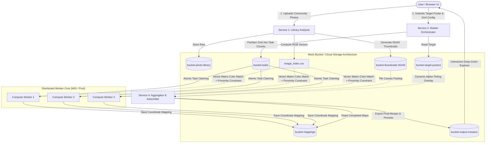

# ❖ PixelMosaic — Distributed Crowd-Sourced Art Mosaic Generator

[](https://www.python.org/downloads/)
[](https://www.docker.com/)
[](https://cloud.google.com/)

> **The Concept**: A collaborative digital art project. A user uploads an iconic target poster (famous movie poster, landmark, or pop culture icon). The cluster scans a public bucket containing hundreds of thousands of random user-contributed photos, and reconstructs a massive mosaic masterpiece where every single pixel is replaced by a mathematically color-matched mini-photo.

---

## 🏗️ 4 Decoupled Microservices Architecture



---

## ⚡ Key Showcase Features

### 1. Vectorized NumPy Color Distance Matching
Workers compute thousands of candidate distances per second using vector broadcasting. It supports both standard Euclidean L2 distance and **perceptually weighted Redmean color distance** ($\Delta C$):
$$\Delta C = \sqrt{(2 + \bar{r}/256)\Delta r^2 + 4\Delta g^2 + (2 + (255-\bar{r})/256)\Delta b^2}$$
where $\bar{r} = (r_1 + r_2) / 2$. This matches colors according to human eye sensitivity (higher sensitivity to greens and reds).

### 2. "No-Repeat" Proximity Constraint Algorithm
Prevents identical community photos from clustering when color distributions are skewed (e.g., hundreds of blue sky photos). Workers enforce a configurable Chebyshev coordinate radius ($r \ge 5$ blocks), disqualifying or penalizing repeated images within nearby cells.

### 3. Dynamic "Color Bleeding" / Tinting Slider
Mathematical alpha blending in the Assembler combines the raw mosaic canvas $M$ with the original target image $T$:
$$I_{\text{final}} = (1 - \alpha) \cdot M + \alpha \cdot T$$
Adjustable in real time from **0% (100% pure community photos)** to **30%+ (enhanced poster definition)**.

### 4. Live Horizontal Auto-Scaling Visualizer
An interactive dashboard displaying:
- Real-time telemetry: `[Cluster Status: IDLE / HIGH WORKLOAD]`, Active Workers count, CPU load, and Photo Catalog size.
- Animated Worker Node cards tracking chunk claiming, execution progress bars, and state changes.
- Streaming cluster log terminal detailing worker lifecycle (`[Spawning Worker-1...]`, `[Decommissioning Worker-1...]`).

### 5. Interactive Deep-Zoom Mosaic Explorer
Allows users to pan and zoom from full poster view down to individual 50×50 px source photo tiles, complete with a floating tile inspection tooltip displaying exact coordinate and match metadata.

---

## 🚀 Quick Start (Local Sandbox)

The system includes a zero-cost local sandbox that mirrors GCP Cloud Storage buckets using local directories.

### 1. Prerequisites
- Python 3.11+
- Dependencies: `pip install -r requirements.txt` (or pre-installed in your environment)

### 2. Launch the Application
Start the master server and interactive web UI:
```bash
python web/server.py 8080
```
Open **[http://127.0.0.1:8080](http://127.0.0.1:8080)** in your browser.

### 3. Running via Docker Compose
To run all 4 microservices in isolated containers with shared volume storage:
```bash
docker compose up --build
```

---

## 📁 Repository Structure

```
PixelMosaic/
├── storage/                       # Local sandbox mirroring Cloud Storage buckets
│   ├── bucket-photo-library/      # Raw user-contributed JPEG photos
│   ├── bucket-thumbnails/         # 50x50 px pre-processed thumbnails
│   ├── bucket-target-posters/     # Target artwork posters
│   ├── bucket-tasks/              # Pending grid task chunks
│   ├── bucket-tasks-processing/   # Claimed active chunks
│   ├── bucket-mappings/           # Worker coordinate mappings
│   ├── bucket-output-mosaics/     # Final rendered mosaics & previews
│   └── metadata/                  # image_index.csv, jobs.json, cluster_state.json
├── core/
│   ├── config.py                  # Storage paths and system defaults
│   ├── color_math.py              # Vectorized Redmean & No-Repeat algorithms
│   └── cluster_engine.py          # Worker auto-scaling & cluster telemetry
├── services/
│   ├── library_analyzer.py        # Service 1: Ingestion & Pre-Processing
│   ├── job_splitter.py            # Service 2: Master Orchestrator
│   ├── compute_worker.py          # Service 3: Distributed Worker Core
│   └── stitcher.py                # Service 4: Aggregator & Assembler
├── web/
│   ├── server.py                  # HTTP API server & static file host
│   ├── templates/
│   │   └── index.html             # Studio, Visualizer, Viewer, and Library tabs
│   └── static/
│       ├── css/style.css          # Glassmorphism dark-mode UI
│       └── js/app.js              # Real-time telemetry, deep-zoom, & live tinting
├── scripts/
│   └── seed_library.py            # Generates sample photos and target posters
├── docker-compose.yml             # 4-service container orchestration
├── Dockerfile                     # Production container image
├── requirements.txt               # Dependencies
└── README.md
```

---

## ☁️ Google Cloud Platform (GCP) Deployment Mapping

| Microservice | Local Sandbox Implementation | GCP Production Target |
| :--- | :--- | :--- |
| **Storage Buckets** | `storage/bucket-*` directories | Google Cloud Storage (GCS) Buckets |
| **Service 1: Library Analyzer** | `services/library_analyzer.py` | Cloud Function triggered on GCS Object Finalize |
| **Service 2: Master Orchestrator** | `services/job_splitter.py` | Cloud Run or lightweight E2 VM |
| **Service 3: Worker Core** | `services/compute_worker.py` | Managed Instance Group (MIG) with Auto-Scaling (0 to 3 VMs) |
| **Service 4: Stitcher** | `services/stitcher.py` | Cloud Run job or high-memory VM |
